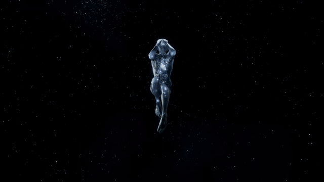
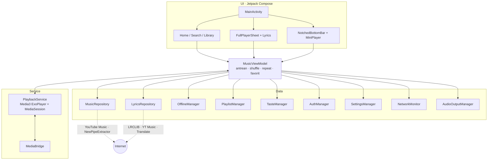

<div align="center">

<a href="assets/banner.mp4">
  
</a>

<sub>▶ Ketuk banner untuk menonton video penuh</sub>

<br/>

# A V O R A

**Pemutar musik Android yang ringan, bebas iklan, dengan nuansa monokrom hitam-putih dan sentuhan _liquid glass_.**

Dibangun murni dengan Kotlin, Jetpack Compose (Material 3) dan AndroidX Media3.

<br/>


[](https://github.com/mmhdzaidie-dev/avora/actions)

[Fitur](#-fitur-utama) ·
[Tampilan](#-desain--tampilan) ·
[Arsitektur](#-arsitektur) ·
[Teknologi](#-teknologi) ·
[Build](#-cara-build) ·
[Privasi](#-privasi--keamanan) ·
[FAQ](#-faq--pemecahan-masalah)

</div>

---

## Daftar Isi

- [Tentang Avora](#-tentang-avora)
- [Avora dalam Angka](#-avora-dalam-angka)
- [Fitur Utama](#-fitur-utama)
- [Desain & Tampilan](#-desain--tampilan)
- [Tur Layar](#-tur-layar)
- [Cara Pakai](#-cara-pakai)
- [Arsitektur](#-arsitektur)
- [Menyelami Cara Kerjanya](#-menyelami-cara-kerjanya)
- [Penyimpanan Data](#-penyimpanan-data)
- [Kustomisasi](#-kustomisasi)
- [Teknologi](#-teknologi)
- [Struktur Proyek](#-struktur-proyek)
- [Izin Aplikasi](#-izin-aplikasi)
- [Cara Build](#-cara-build)
- [Build Otomatis (GitHub Actions)](#-build-otomatis-github-actions)
- [Penandatanganan APK](#-penandatanganan-apk)
- [Privasi & Keamanan](#-privasi--keamanan)
- [Kredit & Terima Kasih](#-kredit--terima-kasih)
- [FAQ & Pemecahan Masalah](#-faq--pemecahan-masalah)
- [Catatan & Disclaimer](#-catatan--disclaimer)

---

## ✦ Tentang Avora

Avora adalah pemutar musik untuk Android yang dibuat dengan fokus pada tiga hal:

1. **Rasa premium**: antarmuka monokrom bersih, animasi pegas, dan efek _liquid glass_ ala iOS 26 pada bottom bar, mini player, dan lirik.
2. **Kebiasaan yang sudah dikenal**: pemutar layar penuh, lirik layar penuh, kartu media di notifikasi/layar kunci, dan alur playlist yang terasa seperti aplikasi streaming besar.
3. **Ringan dan privat**: tanpa iklan, tanpa Firebase, tanpa analytics. Semua data pribadi (favorit, playlist, statistik dengar, unduhan) disimpan lokal di perangkat.

### Kenapa Avora?

| | Avora | Aplikasi streaming umumnya |
|---|---|---|
| Iklan | **Tidak ada** | Sering ada di versi gratis |
| Tracker / analytics | **Tidak ada** | Hampir selalu ada |
| Rekomendasi | Dihitung **di perangkat** | Dihitung di server |
| Terjemahan lirik | **133 bahasa**, berdampingan dengan lirik asli | Terbatas |
| Offline | Otomatis saat internet mati, file **privat** | Sering berbayar |
| Ukuran UI | **Menyesuaikan** DPI & layar tiap HP | Tetap |
| Tampilan | Monokrom + _liquid glass_ | Beragam |

---

## ✦ Avora dalam Angka

| | |
|---|---|
| **Versi** | 3.4.0 (build 23) |
| **Android minimum** | 8.0 (API 26) |
| **Android target** | 14 (API 34) |
| **File Kotlin** | 41 file |
| **Baris kode** | ±11.000 baris Kotlin |
| **Layar utama** | 3 (Home, Search, Library) |
| **Bahasa terjemahan lirik** | 133 |
| **Pilihan kualitas audio** | 3 (±256 / ±128 / ±64 kbps) |
| **Pilihan tema** | 3 (Sistem, Gelap OLED, Terang) |
| **SDK analytics / iklan** | 0 |

---

## ✦ Fitur Utama

### 🎧 Pemutar

| Fitur | Detail |
|---|---|
| **Pemutar layar penuh** | Artwork edge-to-edge dengan scrim gradien, judul + artis, tombol favorit (merah saat disukai), scrubber, **shuffle · rewind · play/pause · fast-forward · repeat**. |
| **Mini player melayang** | Kartu _liquid glass_ di atas bottom bar yang warnanya mengikuti artwork lagu. |
| **Antrean otomatis (Automix Radio)** | Memutar lagu dari hasil pencarian otomatis mengisi antrean dengan lagu radio serupa, dan menambah lagi saat antrean hampir habis. |
| **Lewati otomatis** | Jika sebuah lagu gagal di-resolve atau error, Avora melompat ke lagu berikutnya tanpa berhenti. |
| **Pemilih output audio** | Pil di pemutar menampilkan perangkat aktif (speaker, kabel/jack/USB-C, atau Bluetooth) dan membuka pengaturan audio sistem. |
| **Pemutaran latar belakang** | Foreground service dengan _MediaSession_. Musik **tetap jalan** saat pindah aplikasi, membuka game, atau menggeser Avora dari recents. |
| **Kualitas audio** | High (M4A, bitrate tertinggi / ±256 kbps), Normal (±128 kbps), atau Data Saver (bitrate terendah / ±64 kbps). |
| **Cache URL stream** | URL audio yang sudah di-resolve disimpan sementara agar lagu yang sama terbuka lebih cepat. |

### 📝 Lirik

- **Lirik tersinkronisasi (LRC)** dengan auto-scroll yang menjaga baris aktif di tengah dan indikator aksen di baris yang sedang dinyanyikan.
- **Halaman lirik layar penuh** bergaya Spotify: header judul/artis, lirik besar, baris tombol terjemah + bagikan, scrubber, dan play/pause di bawah. Latar berwarna dari artwork yang di-dim agar tetap terbaca.
- **Sumber berlapis**: LRCLIB lebih dulu (pencarian tepat dengan durasi, lalu pencarian pintar yang mencocokkan durasi ±2,5 detik, lalu pencarian umum), dan jika kosong, **fallback ke lirik resmi YouTube Music**.
- **Pembersihan judul & artis** otomatis (hapus embel-embel seperti "Official Video") supaya pencocokan lirik lebih akurat.
- **Terjemahan ke 133 bahasa**: pilih bahasa dari daftar, baris terjemahan tampil berpasangan dengan lirik asli. Default mengikuti bahasa perangkat bila didukung, kalau tidak, Indonesia. Ganti bahasa saat lagu berjalan langsung menerjemahkan ulang lirik yang sedang tampil.
- **Cache lirik** di disk + _negative cache_ 7 hari untuk lagu yang memang tidak punya lirik, supaya tidak ada request sia-sia.

### 📚 Library & Playlist

- **Liked Songs** disimpan lokal, bisa disinkronkan dari akun YouTube Music.
- **Playlist sendiri**: buat, ganti nama, hapus, tambah/hapus lagu, putar semua atau **acak**. Lagu duplikat dicegah otomatis.
- **Editor cover playlist**: pilih foto dari galeri (galeri digambar langsung di Compose lewat MediaStore), lalu **crop** dengan pinch-to-zoom + drag, dengan garis bantu rule-of-thirds. Hasil disimpan 800×800 JPEG di penyimpanan privat. Tanpa cover kustom, playlist memakai kolase otomatis.
- **Tab segmented** Liked Songs / Playlists dan tampilan detail playlist.

### ⬇️ Mode Offline

- **Unduh per lagu** atau **Unduh semua** untuk playlist dan Liked Songs, lengkap dengan progres per lagu dan progres batch.
- Unduhan memakai **potongan Range** (googlevideo membatasi satu request besar), bisa dibatalkan kapan saja. Unduhan setengah jadi dari sesi sebelumnya dibersihkan saat aplikasi dibuka.
- File disimpan di **penyimpanan internal privat** aplikasi: tidak muncul di galeri, file manager, atau aplikasi lain, dan ikut terhapus saat Avora di-uninstall. Cover art ikut disimpan untuk tampilan offline.
- **Otomatis, bukan tombol manual**: `NetworkMonitor` hanya menganggap perangkat _online_ bila Android sudah memvalidasi koneksi berinternet. Wi-Fi tanpa internet = offline. Saat offline, Home dan Search diganti tampilan khusus offline.
- Lagu yang sudah diunduh ditandai lencana hijau di samping nama artis.

### 🧠 Rekomendasi di Perangkat

- `TasteManager` mencatat **putar, suka, ulang, dan lewati** untuk menghitung skor selera, murni lokal.
- Memberi statistik: total putaran, jumlah artis unik, **artis teratas**, dan **lagu teratas**.
- **Listening Stats** di menu profil: kartu ringkasan, grafik batang vertikal, dan distribusi progres horizontal. Riwayat **Recents** menyimpan 30 lagu terakhir.
- Dibatasi 100 entri lagu agar penyimpanan tidak membengkak.

### 🔎 Home & Search

- **Home**: avatar profil di kiri + chip genre (Semua, Pop, Lo-Fi, Rock, Acoustic, Anime, Hip-Hop, R&B, Top Global), lalu _shelf_ carousel bergaya YouTube Music dan daftar Trending.
- **Search**: saran otomatis (autocomplete) dan grid kategori jelajah (Top Global Hits, Lo-Fi Chill Beats, Anime & J-Pop, Hip-Hop Classics, Acoustic & Folk, Deep Focus & Study, Rock & Alternative, Electronic & Dance).
- Pencarian memprioritaskan **YouTube Music (lagu murni)**, dengan **NewPipeExtractor** sebagai cadangan. Thumbnail otomatis dinaikkan ke resolusi tertinggi yang tersedia.

### 👤 Akun (Opsional)

- Login lewat **WebView** ke akun Google/YouTube Music, tanpa memasukkan password ke aplikasi lain. Nama dan avatar diambil otomatis, dan Liked Songs bisa disinkronkan.
- Avora bisa dipakai penuh **tanpa login**.
- Menu profil: Listening Stats, Recents, Pengaturan, tambah/ganti akun, dan logout.

### ⚙️ Pengaturan

| Pengaturan | Pilihan |
|---|---|
| **Kualitas audio** | High · Normal · Data Saver |
| **Tema** | Sistem · Gelap (OLED hitam pekat) · Terang |
| **Terjemahan lirik** | Aktif/nonaktif + pilihan bahasa |
| **Penyimpanan & cache** | Lihat ukuran cache, bersihkan cache, kelola unduhan |

### 🔔 Kontrol Sistem (Notifikasi & Layar Kunci)

- Kartu media bergaya Spotify: tombol **sebelumnya / play-pause / berikutnya** ditambah tombol **suka** dan **repeat** yang ikonnya mengikuti status aplikasi.
- Saat **dijeda**, kartu menjadi ringkas (judul, artis, tombol play) tanpa seek bar dan tombol tambahan, persis seperti Spotify.
- Judul lagu dengan "(feat. X)" dipindah ke baris artis, misalnya `Lil Peep, rainy bear`.

---

## ✦ Desain & Tampilan

- **Monokrom**: palet hitam–putih–abu (`#000000`, `#0D0D0D`, `#161616`, `#262626`, `#FFFFFF`) dengan satu aksen hijau `#1ED760` untuk status unduhan dan merah `#FF3B30` untuk favorit.
- **Liquid glass** (`GlassSurface`): badan buram tembus pandang yang mengambil warna artwork, kilau spekular di tepi atas, _rim light_ terang di kiri atas yang memudar ke kanan bawah, dan bayangan melayang. Blur memakai `RenderEffect` pada **Android 12+**; di versi lebih lama tampil dengan fallback tanpa blur.
- **Notched bottom bar**: ikon aktif mengambang di lingkaran kaca di dalam lekukan (_notch_) yang **meluncur ke item terpilih dengan animasi pegas**. Bar digambar di atas konten sehingga daftar lagu bergulir di bawahnya.
- **Skala UI adaptif**: semua dp/sp dikalikan satu faktor dari lebar layar terkecil (acuan 411dp, faktor kompak 0,9, batas 0,7 sampai 1,15), jadi tampilan terasa sama di berbagai DPI dan ukuran layar. Ukuran font pilihan pengguna tetap dihormati.
- **Tipografi**: keluarga **Outfit** (Regular, Medium, SemiBold, Bold) dan **Fredoka Bold** untuk aksen.
- **Banner pesan sendiri** menggantikan Toast sistem, digambar paling atas.

---

## ✦ Tur Layar

<table>
<tr>
<td width="50%" valign="top">

### 🏠 Home
- Avatar profil di kiri dan **chip genre** yang bisa digeser: Semua, Pop, Lo-Fi, Rock, Acoustic, Anime, Hip-Hop, R&B, Top Global.
- Memilih chip langsung memuat lagu genre itu; "Semua" kembali ke Trending.
- **Shelf carousel** ala YouTube Music dan daftar **Trending Now**.
- Ketuk avatar untuk membuka menu profil.

</td>
<td width="50%" valign="top">

### 🔎 Search
- Kolom cari dengan **saran otomatis** saat mengetik.
- **Grid kategori** jelajah dengan 8 kategori siap pakai.
- Hasil memprioritaskan lagu murni dari YouTube Music.
- Mengetuk hasil memutar lagu dan mengisi antrean radio otomatis.

</td>
</tr>
<tr>
<td width="50%" valign="top">

### 📚 Library ("Your Collection")
- Pil segmented **Liked Songs** dan **Playlists**.
- Tombol buat playlist, kolase cover otomatis atau foto kustom.
- Detail playlist: putar, acak, **Unduh semua**, edit nama/cover, hapus lagu.
- Liked Songs juga punya tombol **Unduh semua**.

</td>
<td width="50%" valign="top">

### 🎵 Pemutar Penuh
- Artwork edge-to-edge dengan scrim yang menyatu ke latar.
- Baris kontrol: shuffle, rewind, **play/pause 72dp**, fast-forward, repeat.
- Baris utilitas: pilihan output audio, lirik, tambah ke playlist, pengaturan.
- **Geser ke atas** untuk membuka lirik.

</td>
</tr>
<tr>
<td width="50%" valign="top">

### 📝 Lirik Layar Penuh
- Latar warna artwork yang di-dim.
- Baris aktif disorot dan di-scroll ke tengah.
- Tombol **terjemah** + pilih bahasa, dan **bagikan**.
- Scrubber dan play/pause tetap di bawah.

</td>
<td width="50%" valign="top">

### 💠 Mini Player & Bottom Bar
- Mini player kaca melayang dengan warna dari artwork.
- Bottom bar berlekuk: ikon aktif **meluncur** ke item terpilih.
- Konten bergulir di bawah kaca, dengan ruang cadangan agar item terakhir tidak tertutup.

</td>
</tr>
<tr>
<td width="50%" valign="top">

### 👤 Menu Profil
- Kartu akun: nama, avatar, tambah/ganti akun, logout.
- **Listening Stats**: total putar, artis didengar, grafik batang, distribusi artis.
- **Recents**: 30 lagu terakhir.
- Akses cepat ke **Pengaturan**.

</td>
<td width="50%" valign="top">

### ⚙️ Pengaturan
- Kualitas audio dengan deskripsi tiap opsi.
- Tema Sistem / Gelap / Terang.
- Toggle dan bahasa terjemahan lirik.
- Ukuran cache, tombol bersihkan, versi aplikasi.

</td>
</tr>
</table>

---

## ✦ Cara Pakai

### Instal
1. Unduh APK dari tab **Actions → run terbaru → Artifacts** (`Avora-Music-Release-APK`), atau [build sendiri](#-cara-build).
2. Izinkan **instal dari sumber tidak dikenal** untuk aplikasi pengelola file kamu.
3. Buka APK, pasang, lalu jalankan Avora.
4. Beri izin **notifikasi** (Android 13+) supaya kontrol media muncul di notifikasi dan layar kunci.

### Mulai mendengarkan
1. Di **Home**, pilih chip genre atau ketuk lagu dari Trending. Atau buka **Search** dan ketik judul/artis.
2. Ketuk lagu untuk memutar. Antrean radio terisi otomatis.
3. Ketuk mini player untuk membuka pemutar penuh, lalu **geser ke atas** untuk lirik.
4. Ketuk ikon hati untuk menyukai lagu; ikon **+** untuk memasukkannya ke playlist.

### Dengar offline
1. Buka playlist atau Liked Songs, tekan **Unduh semua**. Atau buka menu opsi sebuah lagu untuk mengunduh satu lagu.
2. Tunggu progres selesai (lencana hijau muncul di samping nama artis).
3. Saat internet mati, Avora **otomatis** masuk mode offline dan hanya menampilkan lagu yang sudah diunduh.

### Terjemahkan lirik
1. Buka lirik layar penuh, ketuk tombol **terjemah**.
2. Pilih bahasa dari daftar 133 bahasa.
3. Terjemahan tampil di bawah tiap baris asli. Ganti bahasa kapan saja, lirik langsung diterjemahkan ulang.

### Sinkronkan Liked Songs dari akun
1. Buka menu profil dan login lewat jendela WebView.
2. Setelah berhasil, nama dan avatar muncul, dan Liked Songs akun ikut disinkronkan.

---

## ✦ Arsitektur

Pola **MVVM** dengan state berbasis `StateFlow`. ViewModel pemutar hidup di level `Application` (bukan Activity) agar antrean, auto-next, dan tombol notifikasi tetap bekerja saat Activity dihancurkan.



### Alur memutar lagu

1. Pengguna mengetuk lagu → `MusicViewModel.playTrack()` menyusun antrean.
2. Jika lagu sudah diunduh, `OfflineManager` memberi file lokal. Jika belum, `MusicRepository` me-resolve URL stream sesuai **kualitas audio** (dengan cache).
3. `MediaController` mengirim item ke `PlaybackService`; ExoPlayer memutar lewat `DefaultDataSource` (mendukung `http(s)` **dan** `file://` untuk lagu offline).
4. `MediaBridge` menyinkronkan status favorit dan repeat ke tombol notifikasi.
5. `LyricsRepository` mengambil lirik (cache → LRCLIB → YouTube Music) dan, bila diminta, menerjemahkannya.
6. `TasteManager` mencatat putar/suka/ulang/lewati untuk rekomendasi lokal.

### Alur lirik

```
cache memori ─► cache disk ─► LRCLIB (3 tahap pencarian) ─► YouTube Music Lyrics
                                                  │
                          (opsional) terjemahan ──┘─► simpan ke cache
```

---

## ✦ Menyelami Cara Kerjanya

<details>
<summary><b>🎛️ PlaybackService: pemutaran yang bandel di latar belakang</b></summary>

<br/>

- Berjalan sebagai `MediaSessionService` dengan tipe foreground `mediaPlayback`.
- `DefaultLoadControl` dengan buffer yang disetel untuk start cepat, dan `WAKE_MODE_NETWORK` menjaga CPU + Wi-Fi tetap hidup saat layar mati.
- `DefaultDataSource` menangani `http(s)` **dan** `file://`, jadi lagu streaming dan lagu offline lewat jalur yang sama.
- `onTaskRemoved`: menggeser Avora dari recents **tidak** menghentikan musik yang sedang diputar. Layanan hanya dimatikan bila tidak ada yang diputar.
- Tombol berikutnya/sebelumnya dari notifikasi dikirim lewat broadcast ke `MusicViewModel`, sehingga logika antrean (termasuk shuffle) tetap satu pintu.
- Saat dijeda, perintah seek dan skip disembunyikan dari kartu sistem agar tampil ringkas, sementara pemutar di dalam aplikasi tetap bisa seek dan skip.

</details>

<details>
<summary><b>🔗 Resolusi stream & kualitas audio</b></summary>

<br/>

`MusicRepository` mengambil daftar stream audio lewat NewPipeExtractor lalu memilih satu sesuai pengaturan:

| Mode | Cara memilih |
|---|---|
| **High** | Stream **M4A** dengan bitrate tertinggi; bila tidak ada M4A, bitrate tertinggi apa pun |
| **Normal** | Stream berbitrate 90–180 kbps yang paling dekat ke 128 kbps; cadangan: stream tengah dari daftar terurut |
| **Data Saver** | Stream dengan bitrate terendah |

URL hasil resolusi di-cache **3 jam** agar memutar ulang lagu yang sama tidak perlu meminta ulang.

</details>

<details>
<summary><b>⬇️ OfflineManager: unduhan yang tahan banting</b></summary>

<br/>

- Antrian unduhan dengan progres `0f..1f` per lagu yang bisa dipantau UI.
- Mengunduh dengan **Range per potongan**, karena googlevideo membatasi satu request besar. Bila server mengabaikan Range dan mengirim seluruh file sekaligus, Avora tetap menanganinya.
- Menyimpan metadata lagu, tipe MIME, ukuran, dan cover art; `totalBytes()` menjumlahkan ukuran semua unduhan untuk ditampilkan di pengaturan.
- Bisa membatalkan satu lagu, menghapus satu lagu, atau menghapus semua unduhan.
- Sisa unduhan setengah jadi dari sesi sebelumnya dihapus saat inisialisasi.

</details>

<details>
<summary><b>📝 Pencocokan lirik yang teliti</b></summary>

<br/>

1. **Cache memori**, lalu **cache disk** (`lyrics_cache_v3`), lalu _negative cache_ (7 hari).
2. Judul dan artis dibersihkan dari embel-embel agar cocok dengan database lirik.
3. **LRCLIB tahap 1**: `get` tepat dengan nama lagu, artis, dan durasi.
4. **LRCLIB tahap 2**: `search` dengan filter durasi; lirik tersinkronisasi diutamakan dan dipilih yang durasinya paling dekat (toleransi ±2,5 detik); cadangan lirik polos.
5. **LRCLIB tahap 3**: pencarian umum `q=judul artis` supaya lirik tersinkron tidak terlewat.
6. **Fallback YouTube Music**: lirik resmi lewat endpoint `next` dan `browse`.
7. Hasil divalidasi (`isValidLyricsText`) agar teks sampah tidak tampil sebagai lirik.
8. Bila terjemahan aktif, baris diterjemahkan dan disimpan bersama lirik. Jika jaringan gagal, lirik asli tetap dipakai dan terjemahan dicoba lagi lain waktu.

</details>

<details>
<summary><b>🧠 TasteManager: selera musik tanpa server</b></summary>

<br/>

- Empat sinyal: **putar**, **suka**, **ulang**, **lewati**, masing-masing mengubah skor sebuah lagu/artis.
- Skor dan riwayat disimpan lewat SharedPreferences, dengan cache di memori supaya tidak serialisasi JSON berulang kali.
- Penyimpanan dipangkas otomatis: maksimal **100 entri lagu** dan **30 recents**.
- Hasilnya dipakai untuk Listening Stats dan daftar artis/lagu teratas.

</details>

<details>
<summary><b>📶 NetworkMonitor: offline yang benar-benar offline</b></summary>

<br/>

Avora mendengarkan perubahan kapabilitas jaringan dan hanya menganggap perangkat _online_ jika Android sudah **memvalidasi** adanya internet. Wi-Fi tanpa internet dihitung offline. Mode offline murni otomatis, tidak ada tombol manual, dan halaman offline kembali sendiri begitu internet tersambung.

</details>

<details>
<summary><b>📐 Skala UI adaptif</b></summary>

<br/>

`AdaptiveDensity` membungkus seluruh tema dan mengalikan `density` dengan:

```
scale = (smallestScreenWidthDp / 411) × 0.9   →  dibatasi 0.7 … 1.15
```

Karena memakai lebar layar **terkecil**, hasilnya tidak berubah saat layar diputar. `fontScale` bawaan pengguna tetap dipertahankan, jadi pengaturan aksesibilitas ukuran font tidak terganggu.

</details>

---

## ✦ Penyimpanan Data

Semua data berada di ruang privat aplikasi dan hilang saat uninstall.

| Data | Lokasi | Catatan |
|---|---|---|
| Favorit | SharedPreferences `avora_favorites` | Bisa disinkronkan dari akun |
| Playlist | SharedPreferences `avora_playlists` | Daftar lagu per playlist |
| Cover playlist | `filesDir/playlist_covers/` | JPEG 800×800, nama file baru tiap ganti agar cache gambar tidak basi |
| Unduhan offline | `filesDir` (internal privat) | Audio + cover art, tak terlihat di galeri |
| Sesi akun | SharedPreferences `avora_auth_prefs` | Cookie dan profil |
| Pengaturan | SharedPreferences | Tema, kualitas, terjemahan |
| Cache lirik | `cacheDir/lyrics_cache_v3/` | Termasuk penanda "tanpa lirik" |
| Cache gambar & HTTP | `cacheDir/image_cache`, `cacheDir/http_cache` | Bisa dibersihkan dari Pengaturan |

Tombol **Bersihkan cache** di Pengaturan menghapus cache lirik, gambar, dan HTTP **tanpa** menyentuh favorit, playlist, atau unduhan.

---

## ✦ Kustomisasi

Beberapa hal yang mudah diubah kalau kamu mem-fork Avora:

| Mau ubah | Edit di | Cara |
|---|---|---|
| Ukuran UI global | `ui/theme/Theme.kt` | `COMPACT_FACTOR`, `MIN_UI_SCALE`, `MAX_UI_SCALE` |
| Palet warna | `ui/theme/Color.kt` | Ganti nilai hex warna |
| Font | `res/font/` + `ui/theme/Type.kt` | Ganti file TTF dan definisi `FontFamily` |
| Chip genre Home | `ui/screens/HomeScreen.kt` | Daftar `genres` |
| Kategori Search | `ui/screens/SearchScreen.kt` | Daftar `browseCategories` |
| Bahasa terjemahan | `data/lyrics/TranslationLanguages.kt` | Daftar `all` dan `FALLBACK` |
| Batas riwayat/skor | `data/recommendation/TasteManager.kt` | `MAX_RECENTS`, `MAX_TRACK_ENTRIES` |
| Lama cache stream | `data/remote/MusicRepository.kt` | `CACHE_EXPIRY_MS` |
| Nama & ikon aplikasi | `res/values/strings.xml`, `res/mipmap-anydpi-v26/` | Ganti string dan ikon adaptif |
| Versi aplikasi | `app/build.gradle.kts` | `versionCode`, `versionName` |

---

## ✦ Teknologi

| Bagian | Yang dipakai | Versi |
|---|---|---|
| Bahasa | Kotlin (JVM 17, core library desugaring) | 1.9.24 |
| UI | Jetpack Compose, Material 3, Material Icons Extended | BOM 2024.05.00 |
| Navigasi | Navigation Compose | 2.7.7 |
| Pemutar | Media3 ExoPlayer + MediaSession (`media3-exoplayer`, `-session`, `-common`) | 1.3.1 |
| Sumber audio | [NewPipeExtractor](https://github.com/TeamNewPipe/NewPipeExtractor) | v0.26.5 |
| Jaringan | OkHttp | 4.12.0 |
| Gambar | Coil (Compose) | 2.6.0 |
| Async | Kotlin Coroutines / Flow | 1.8.1 |
| Lifecycle | ViewModel Compose, Lifecycle Runtime | 2.8.0 |
| Build | Android Gradle Plugin / Gradle | 8.4.2 / 8.7 |
| Target SDK | `minSdk 26` · `targetSdk 34` · `compileSdk 34` | |

Layanan eksternal yang dipanggil aplikasi: **YouTube Music / YouTube** (pencarian, stream, akun), **LRCLIB** (lirik), dan **Google Translate** (terjemahan lirik).

---

## ✦ Struktur Proyek

```
avora/
├── app/
│   ├── build.gradle.kts              # konfigurasi modul, signing, dependensi
│   ├── proguard-rules.pro            # aturan R8 untuk build release
│   ├── avora.keystore                # keystore penandatanganan
│   └── src/main/
│       ├── AndroidManifest.xml
│       ├── res/                      # font Outfit & Fredoka, ikon, tema, string
│       └── java/com/zai/avora/
│           ├── MainActivity.kt       # host Compose, nav, overlay pemutar
│           ├── AvoraApp.kt           # Application: init NewPipe & store ViewModel
│           ├── ui/
│           │   ├── theme/            # Color, Type, Theme (+ skala UI adaptif)
│           │   ├── navigation/       # Screen (Home, Search, Library)
│           │   ├── screens/          # HomeScreen, SearchScreen, LibraryScreen
│           │   └── components/       # FullPlayerSheet, MiniPlayer, GlassSurface,
│           │                         # NotchedBottomBar, FullScreenLyricsView,
│           │                         # SyncedLyricsView, PlaylistCoverEditor,
│           │                         # OfflineComponents, SettingsDialog,
│           │                         # ProfileMenuSheet, LoginWebViewDialog, ...
│           ├── viewmodel/            # MusicViewModel
│           ├── service/              # PlaybackService, MediaBridge
│           └── data/
│               ├── remote/           # MusicRepository, AvoraDownloader, HttpClientProvider
│               ├── lyrics/           # LyricsRepository, LrcParser, TranslationLanguages
│               ├── offline/          # OfflineManager
│               ├── playlist/         # PlaylistManager
│               ├── recommendation/   # TasteManager
│               ├── settings/         # SettingsManager
│               ├── auth/             # AuthManager
│               ├── audio/            # AudioOutputManager
│               ├── network/          # NetworkMonitor
│               └── model/            # Track, HomeSection
├── .github/workflows/build-apk.yml   # CI: build APK debug & release
├── build.gradle.kts · settings.gradle.kts · gradle.properties
└── gradlew · gradle/wrapper/
```

---

## ✦ Izin Aplikasi

| Izin | Kegunaan |
|---|---|
| `INTERNET`, `ACCESS_NETWORK_STATE` | Streaming, lirik, dan deteksi online/offline |
| `FOREGROUND_SERVICE`, `FOREGROUND_SERVICE_MEDIA_PLAYBACK` | Pemutaran musik di latar belakang |
| `POST_NOTIFICATIONS` | Kartu media di notifikasi (Android 13+) |
| `WAKE_LOCK` | Menjaga CPU dan Wi-Fi tetap aktif saat layar mati |
| `READ_MEDIA_IMAGES`, `READ_MEDIA_VISUAL_USER_SELECTED`, `READ_EXTERNAL_STORAGE` (≤ SDK 32) | **Hanya** untuk pemilih foto cover playlist |

`allowBackup` dimatikan, jadi data aplikasi tidak ikut tercadangkan otomatis.

---

## ✦ Cara Build

**Syarat:** JDK 17 dan Android SDK (compileSdk 34).

```bash
git clone https://github.com/mmhdzaidie-dev/avora.git
cd avora
chmod +x gradlew

./gradlew assembleDebug       # APK debug  (applicationId berakhiran .debug)
./gradlew assembleRelease     # APK release (R8 + shrink resources)
```

Lokasi hasil build:

```
app/build/outputs/apk/debug/
app/build/outputs/apk/release/
```

> **Catatan:** build debug memakai `applicationIdSuffix = ".debug"`, jadi bisa terpasang berdampingan dengan versi release.

Beberapa dependensi (NewPipeExtractor) diambil dari **JitPack**, yang sudah terdaftar di `settings.gradle.kts`.

---

## ✦ Build Otomatis (GitHub Actions)

Workflow **Build Avora APK** (`.github/workflows/build-apk.yml`) berjalan pada:

- push ke `main`
- pull request ke `main`
- pemicu manual (`workflow_dispatch`)

Langkahnya: Temurin JDK 17 → setup Gradle → build **debug** → unggah artifact → build **release** → unggah artifact. Bila release gagal, langkah khusus merangkum error dari `release.log`. Run lama yang tumpang tindih dibatalkan otomatis (`concurrency`).

Artifact tersedia di halaman run selama **14 hari**:

| Artifact | Isi |
|---|---|
| `Avora-Music-Debug-APK` | APK debug |
| `Avora-Music-Release-APK` | APK release (sudah ditandatangani) |

---

## ✦ Penandatanganan APK

APK release ditandatangani dengan `app/avora.keystore`. Jika kamu mem-fork untuk dipublikasikan sendiri:

1. Buat keystore baru (`keytool -genkeypair ...`).
2. Simpan kredensial di **GitHub Secrets** atau `local.properties`/variabel lingkungan, **jangan** ditulis langsung di `build.gradle.kts`.
3. Jangan commit keystore pribadi ke repositori publik.

---

## ✦ Privasi & Keamanan

- **Tanpa** Firebase, analytics, crash reporter pihak ketiga, atau tracker.
- Playlist, favorit, statistik dengar, riwayat, dan unduhan tersimpan **lokal** di perangkat.
- Rekomendasi dihitung **di perangkat**, tidak ada server analitik.
- Unduhan berada di penyimpanan internal privat dan terhapus saat uninstall.
- Login bersifat **opsional**. Cookie sesi hanya dipakai untuk memanggil layanan YouTube Music atas nama akunmu.
- Satu-satunya lalu lintas jaringan: YouTube Music/YouTube, LRCLIB, dan Google Translate (hanya bila terjemahan lirik aktif).

---

## ✦ FAQ & Pemecahan Masalah

<details>
<summary><b>Musik berhenti saat saya membuka game / aplikasi lain.</b></summary>

Pastikan izin notifikasi diberikan dan Avora tidak dibatasi baterainya. Di sebagian ROM (MIUI, ColorOS, dll.), set Avora ke **"Tanpa batasan"** / _Unrestricted_ di pengaturan baterai agar layanan latar tidak dimatikan sistem.
</details>

<details>
<summary><b>Lirik tidak muncul untuk sebuah lagu.</b></summary>

Avora mencoba LRCLIB lalu lirik YouTube Music. Bila keduanya kosong, lagu ditandai tanpa lirik selama 7 hari agar tidak mengulang request. Ketersediaan lirik bergantung pada sumbernya.
</details>

<details>
<summary><b>Efek kaca tidak terlihat blur.</b></summary>

Blur backdrop memakai `RenderEffect` yang hanya ada di **Android 12+**. Di Android 8–11, efek kaca tampil tanpa blur tetapi tetap berfungsi.
</details>

<details>
<summary><b>Tampilan terasa terlalu besar atau kecil.</b></summary>

Skala UI otomatis mengikuti lebar layar terkecil. Untuk menyesuaikan secara global, ubah `COMPACT_FACTOR` (1.0 = ukuran asli, lebih kecil = UI lebih mungil) di `ui/theme/Theme.kt`.
</details>

<details>
<summary><b>Lagu tidak bisa diputar / stream gagal.</b></summary>

Avora otomatis melompat ke lagu berikutnya jika satu lagu gagal di-resolve. Bila terjadi terus-menerus, periksa koneksi, bersihkan cache dari Pengaturan, dan perbarui aplikasi karena layanan sumber sering berubah.
</details>

<details>
<summary><b>Apakah bisa dipakai tanpa internet?</b></summary>

Bisa untuk lagu yang sudah **diunduh**. Saat offline, Avora otomatis berpindah ke tampilan offline.
</details>

---

## ✦ Kredit & Terima Kasih

| Proyek | Peran di Avora |
|---|---|
| [NewPipeExtractor](https://github.com/TeamNewPipe/NewPipeExtractor) | Pencarian dan ekstraksi stream audio |
| [LRCLIB](https://lrclib.net) | Sumber lirik tersinkronisasi |
| [AndroidX Media3](https://developer.android.com/media/media3) | ExoPlayer dan MediaSession |
| [Jetpack Compose](https://developer.android.com/jetpack/compose) | Seluruh antarmuka |
| [Coil](https://coil-kt.github.io/coil/) | Pemuatan gambar |
| [OkHttp](https://square.github.io/okhttp/) | Jaringan |
| [Outfit](https://fonts.google.com/specimen/Outfit) & [Fredoka](https://fonts.google.com/specimen/Fredoka) | Tipografi |

---

## ✦ Catatan & Disclaimer

Proyek ini dibuat untuk **keperluan pribadi dan pembelajaran**. Pengguna bertanggung jawab memastikan penggunaannya sesuai ketentuan layanan sumber konten dan hukum yang berlaku. Avora tidak berafiliasi dengan YouTube, Google, Spotify, Apple, atau LRCLIB.

<div align="center">

<br/>

**Dibuat dengan ♥ oleh [Zai Dev](https://github.com/mmhdzaidie-dev)**

</div>
